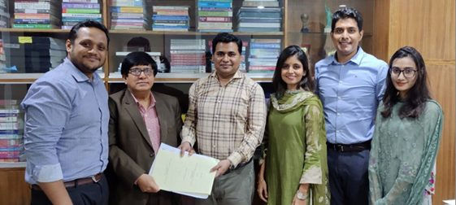

*CodersTrust signing contract with Center for Project Management and Information Systems (PMIS), University of Dhaka in collaboration with Bangladesh Computer Council (BCC) under ICT and Telecommunication Ministry, Bangladesh*

## Objective

The objectives of the wider EDGE project are to improve cybersecurity, build resiliency during future crises and enable the government to operate virtually to deliver critical public services to citizens and businesses. The wider EDGE project, led by the Government of Bangladesh, aims to create 100,000 jobs, with special focus on women, and train 100,000 youth in digital and disruptive technologies. To reduce vulnerabilities from the pandemic and prepare for the Fourth Industrial Revolution, it will also help to digitalize small and medium enterprises and strategic industries. CodersTrust’s contracted scope within the project is to train 1,000 youths, as set out below.

## Scope

CodersTrust will provide training to 1,000 youths on digital and disruptive 4IR technologies.
