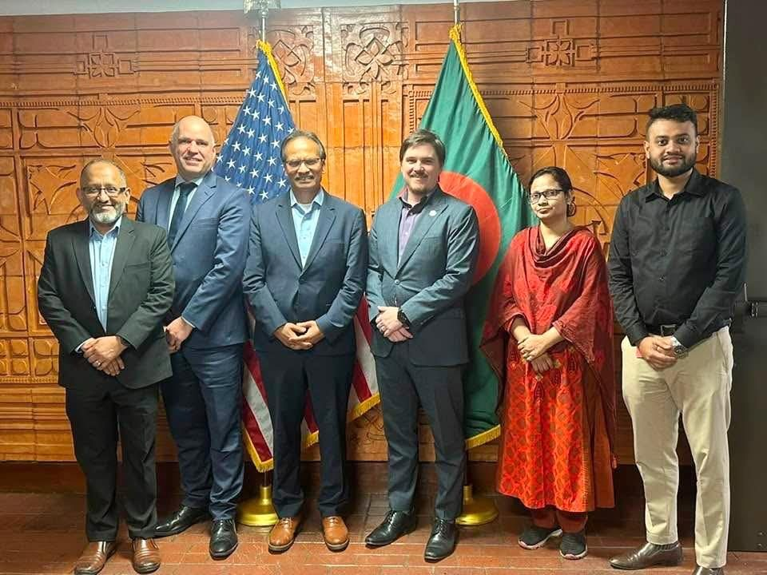
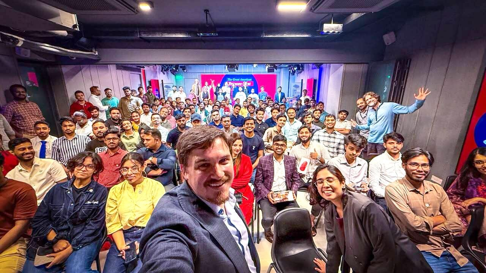

## U.S. Embassy Dhaka and CodersTrust Celebrate a Successful “Great American Treasure Hunt” Marking America’s 250th Anniversary

Our “Great American Treasure Hunt” partnership with the U.S. Embassy Dhaka celebrating America’s 250th anniversary was a huge success! Our Bangladesh team built a gamified digital experience that drew 1,400+ registered users and 15,000+ QR code scans, culminating in a lively in-person trivia finale at the EMK Center.

This is what CodersTrust is all about: using digital skills to build real, meaningful platforms. To our clients, students, funders, and well-wishers: this milestone belongs to you too.

Since 2014, we’ve trained 130,000+ learners and worked in 16 countries and territories, with major operations in Bangladesh, empowering youth and underserved communities to build real economic opportunity.

Here’s to lifting educated youth in Bangladesh and beyond, and to many more collaborations ahead.

Learn a skill, the world is yours.
