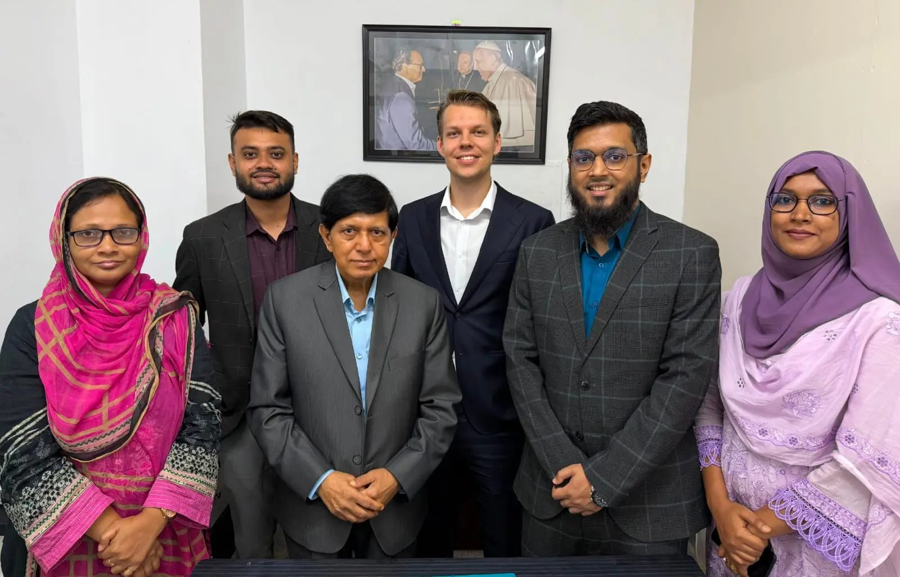

DHAKA, BANGLADESH — CodersTrust Bangladesh has officially signed a strategic Memorandum of Understanding (MOU) with RemoteIntegrity, a Florida-based U.S. technology organization, marking a major milestone in driving global workforce inclusion for Bangladeshi tech talent.

The agreement was signed by Md. Shamsul Haque (CEO & Principal, CodersTrust Bangladesh) and Colin Koenig (CEO, RemoteIntegrity).

Through this strategic collaboration, CodersTrust aims to bridge the gap between local skill acquisition and international employment. The partnership aims to support top-performing and qualified program completers with international placement through targeted placement initiatives, specialized readiness training and client interview preparation aligned with international standards.

Talent is universal, even when opportunity isn’t. By partnering with RemoteIntegrity, we are taking our commitment to the success of program completers to the next level—connecting Bangladesh’s skilled workforce with high-value international careers.

This initiative reinforces CodersTrust’s founding mission to empower youth through high-demand digital skills and create sustainable career pathways in the global digital economy.
