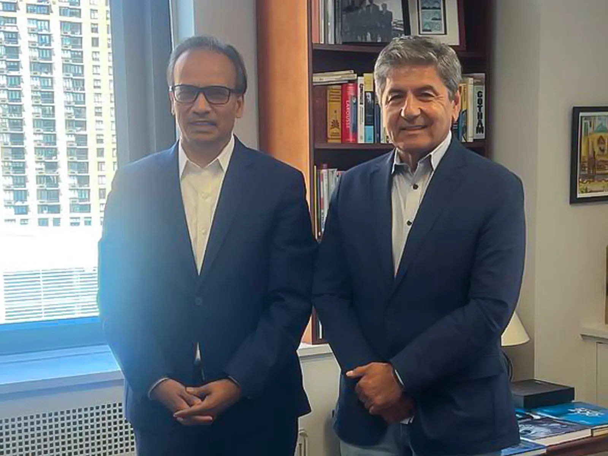

Aziz Ahmad, Chairman of CodersTrust and CEO of UTC Associates, recently visited City College Downtown, where he met with representatives to discuss expanding the existing partnership between CodersTrust and the City College of New York (CCNY), which began with a memorandum of understanding (MOU) signed in April 2024, through the Continuing and Professional Studies Program.

The meeting explored the possibility of making selected professional and career-focused courses available to an international audience through an expanded partnership. The initiative could leverage Mr. Ahmad’s global connections and experience in workforce development to expand access to industry-relevant learning opportunities for learners beyond the United States.

Mr. Ahmad, an alumnus of CCNY, leads CodersTrust—a global workforce development and EdTech provider that has trained 130,000+ learners since 2014 and worked in 16 countries and territories. The organization specializes in digital skills development, ranging from K–12 STEM, coding, and robotics to advanced technical and business training for the digital economy.

An expanded partnership would align closely with CodersTrust’s core mission to empower underrepresented communities, particularly youth and women, by equipping them with market-relevant skills and connecting them to global career opportunities to foster financial independence.

As discussions progress, the expanded partnership could create new opportunities for knowledge sharing and international learning, bringing together CCNY’s continuing education offerings and CodersTrust’s global workforce development network.
