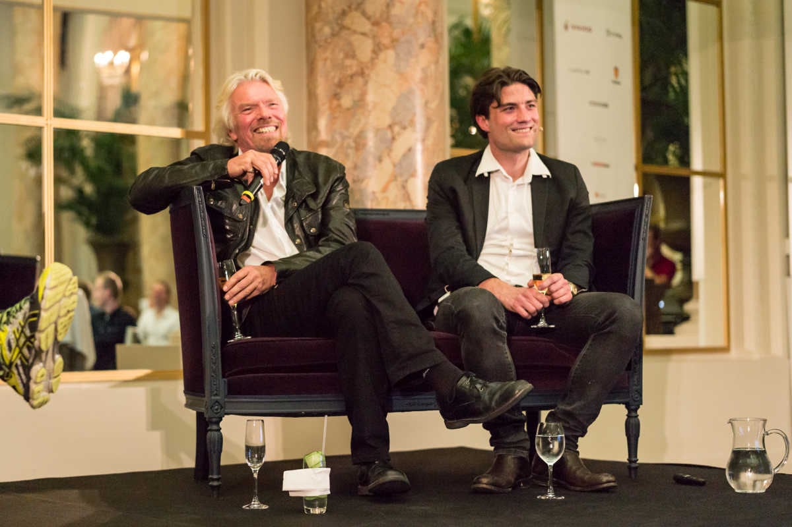

CodersTrust launched in Copenhagen, Denmark, in April 2014, at a Virgin Unite dinner held in the presence of Sir Richard Branson and early Skype investor Morten Lund.

The dinner took place on April 8, 2014, in the palm court of the Hotel d’Angleterre, with talks on entrepreneurship, CodersTrust’s vision and a question-and-answer session. All guests were then invited to a party at CodersTrust’s Copenhagen offices. The Danish business daily [Børsen](https://web.archive.org/web/20150225060207/http://borsen.dk/nyheder/avisen/artikel/11/79278/artikel.html) wrote about the evening that day, and CodersTrust’s own [event page](https://web.archive.org/web/20140701090101/http://coderstrust.com/copenhagen-event) describes it.

That month, CodersTrust signed an agreement in Copenhagen with Grameen Solutions Ltd to train IT freelancers in Bangladesh, as [The Daily Star](https://www.thedailystar.net/grameen-solutions-aims-to-create-1-lakh-it-freelancers-in-4-years-22720) reported on May 4, 2014.
