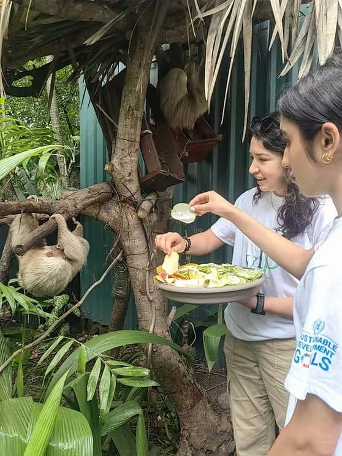

CodersTrust shared a global opportunity with its learner community through its official partner, University for Peace (UPEACE), located in San José, Costa Rica.

UPEACE was accepting applications for its prestigious “Young Leaders for Peace (YLP)” Summer Programme 2026, designed specifically for high school students who aspire to become impactful leaders and changemakers.

## About the Program

The Young Leaders for Peace (YLP) program is an intensive, two-week immersive learning experience that empowers students with the knowledge, mindset, and practical skills required to become effective peacebuilders and socially responsible leaders.

Participants engaged in interactive sessions, leadership development activities, and global discussions that encourage critical thinking, collaboration, and real-world problem-solving.

## Program Details

- Program Name: Young Leaders for Peace (YLP)
- Dates: June 14 to June 28, 2026 (completed)
- Location: UPEACE Headquarters, San José, Costa Rica
- Eligibility: High school students (rising sophomores, juniors, and seniors)

## Why This Matters

This program is more than just a summer learning experience. It offers students a unique opportunity to step into a global environment where they can develop leadership qualities, understand peacebuilding practices, and contribute to meaningful international conversations.

Through this initiative, CodersTrust continues its mission to go beyond technical education by nurturing essential soft skills such as leadership, communication, and global awareness.

## A Pathway to Global Leadership

At CodersTrust, we believe that future leaders need both technical expertise and the ability to create positive social impact. The YLP program serves as a powerful platform for students to begin their journey toward becoming responsible global citizens.

Eligible students within the CodersTrust network were encouraged to take this step toward shaping a better, more peaceful world.

## Program Information

The 2026 program has concluded. Program details remain available from UPEACE.

- [Explore Program Details](https://www.upeaceny.org/young-leaders-for-peace)
- [Download Brochure](https://www.upeaceny.org/_files/ugd/cb3bb5_52599eefe4a84fecb7dc5d38225a2b8e.pdf)

