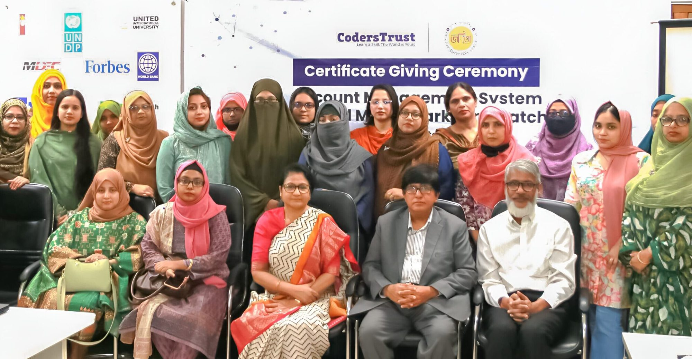
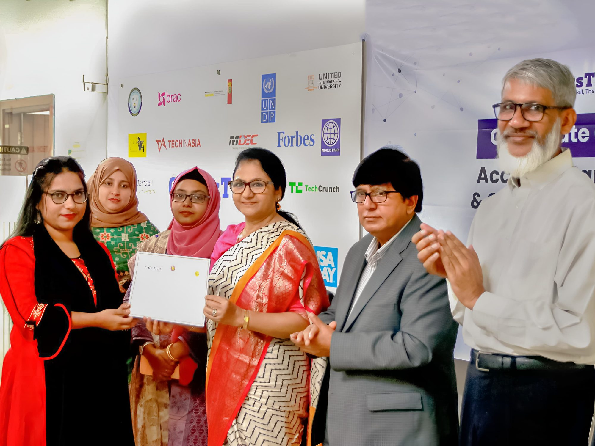
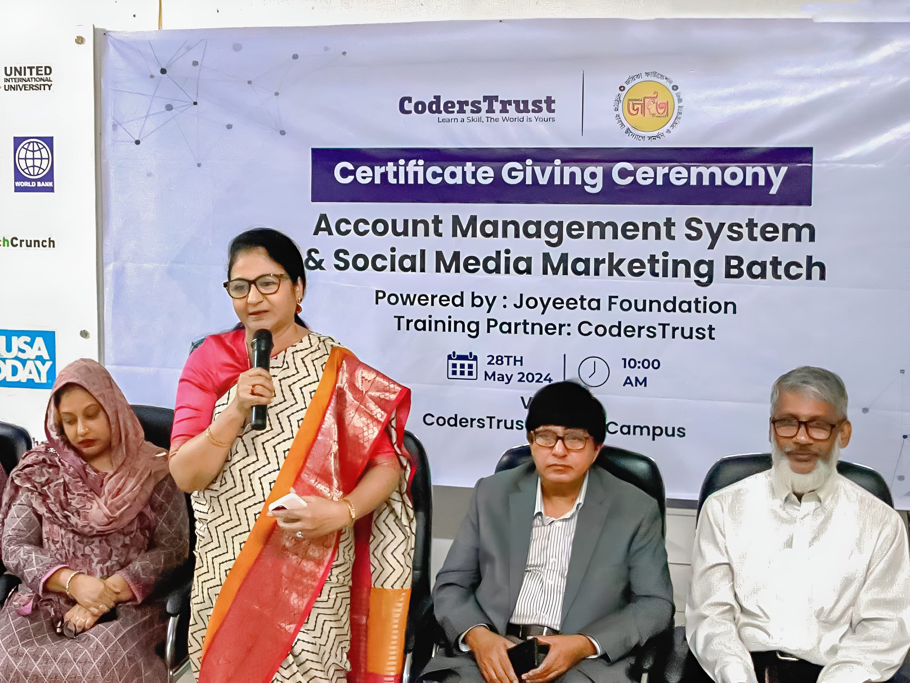
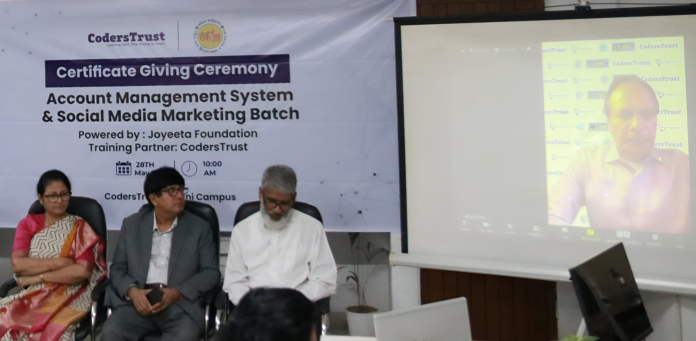
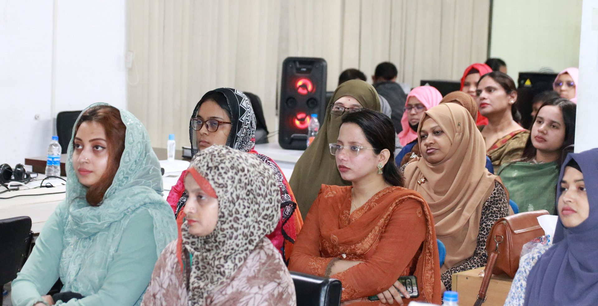
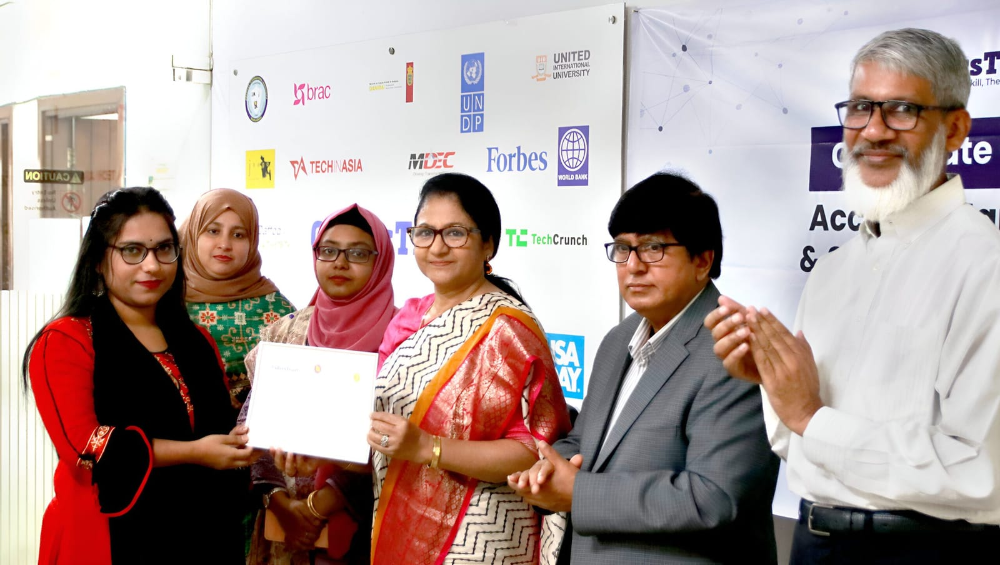
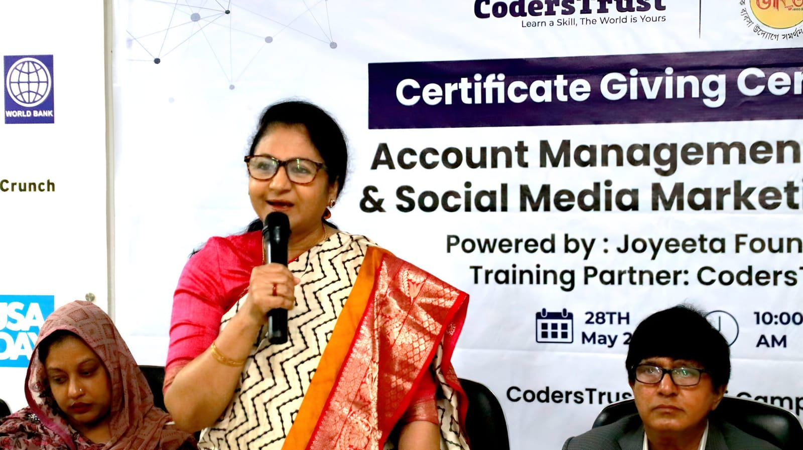

Dhaka, Bangladesh

On May 28, 2024, CodersTrust, in collaboration with the Joyeeta Foundation, celebrated a significant milestone with a certificate-giving ceremony and graduation event for women who have completed advanced training in social media marketing and accounts management systems. This initiative aims to empower women through advanced training and education.

Ms. Afroza Khan, Managing Director of the Joyeeta Foundation and former Secretary to the Bangladesh government, expressed her gratitude during the event. She praised CodersTrust’s unwavering commitment to creating a brighter, more inclusive future. Ms. Khan emphasized the crucial role women will play in Bangladesh’s technology sector, noting that CodersTrust’s innovative methodologies and dedicated mentorship are equipping program completers with essential skills for success in the digital economy.

Aziz Ahmad, Chairman of CodersTrust, joined the event virtually from Geneva, Switzerland. He celebrated the program completers and highlighted the importance of this initiative in fostering a more equitable and technologically advanced Bangladesh. “This collaboration marks a significant step towards a more equitable and technologically advanced Bangladesh. Thank you to everyone involved, especially the Joyeeta Foundation, for making this possible!” he said.

CodersTrust is a global EdTech-based workforce development and skill-oriented education provider that has trained learners since 2014 and has worked in 16 countries and territories. Its programs range from K-12 STEM, coding and robotics to professional skills and advanced technology skills for the digital era.

CodersTrust’s mission is to transform underprivileged, disadvantaged and marginalized communities, especially youth and women, into skilled professionals and connect them with work opportunities to enable financial independence and economic growth on a global scale. CodersTrust has developed a sustainable and scalable market-based model for providing skill-focused training to youth worldwide, designed to support employment, upward social mobility and durable social impact.

