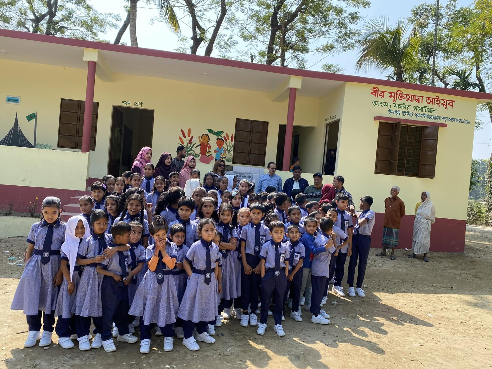

## For CodersTrust Chairman Aziz Ahmad, True Wealth Lies in Changing Lives

Success is often measured by wealth, titles, or recognition. But for Aziz Ahmad, Co-Founder and Chairman of CodersTrust, success has always meant something far greater—creating opportunities for others.

A recently released video by content creator Jana Alam Jhony offers a glimpse into the personal life of the globally recognized technology leader, portraying a man whose life is defined not by luxury, but by humility, compassion, and an unwavering commitment to giving back. Despite achieving international success, Mr. Ahmad continues to embrace a simple lifestyle, proving that true greatness is measured by the lives we impact.

https://www.youtube.com/watch?v=rQC8BaL71QI

As the Co-Founder and Chairman of CodersTrust, Mr. Ahmad has dedicated his career to making quality digital education affordable and accessible for everyone. Since its founding in 2014, CodersTrust has trained 130,000+ learners with future-ready digital skills and has worked in 16 countries and territories, supporting young people as they pursue careers in the global digital economy.

Beyond technology, Mr. Ahmad remains deeply connected to Bangladesh’s roots through his passion for farming. More than a personal interest, agriculture represents his belief in self-reliance, sustainability, and the importance of staying connected to the land. He also holds the conviction that education is the most effective path to breaking the cycle of poverty.

This vision is further reflected in the Bir Muktijoddha Ayub Ahmed Master Memorial Institute, an educational initiative being developed. The institute aims to provide quality education to underprivileged children, helping them build brighter futures while contributing to a more educated and prosperous Bangladesh.

Throughout his journey, Mr. Ahmad has demonstrated that technology should serve humanity. Whether through expanding access to digital skills, creating employment opportunities, or investing in education at the grassroots level, his mission has remained consistent—empowering people to transform their own lives with dignity and opportunity.

His story is also a powerful reminder that patriotism extends beyond words. Even while building a successful global career, Mr. Ahmad continues to invest in Bangladesh’s greatest asset—its people. By nurturing talent, supporting education, and creating pathways to meaningful employment, he is helping shape a future where Bangladeshi youth can compete confidently on the global stage.

At a time when success is often associated with material wealth, Mr. Ahmad’s journey offers a refreshing perspective: real leadership is measured by service, real prosperity is created by empowering others, and lasting success is defined by the positive impact we leave on society.

Learn more about Bir Muktijoddha Ayub Ahmed Master Memorial Institute:
[https://www.facebook.com/profile.php?id=61572984577021](https://www.facebook.com/profile.php?id=61572984577021)

